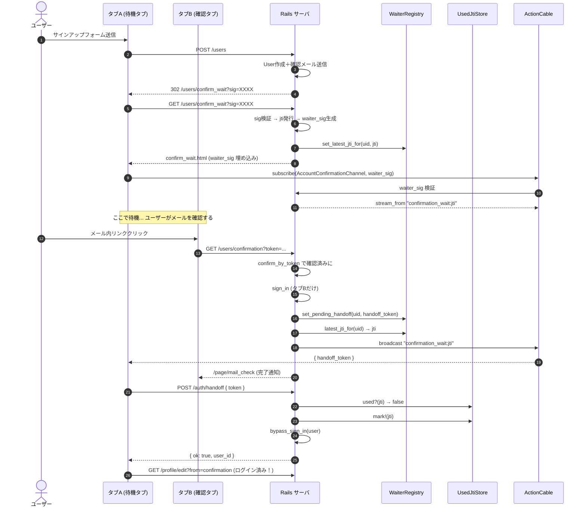
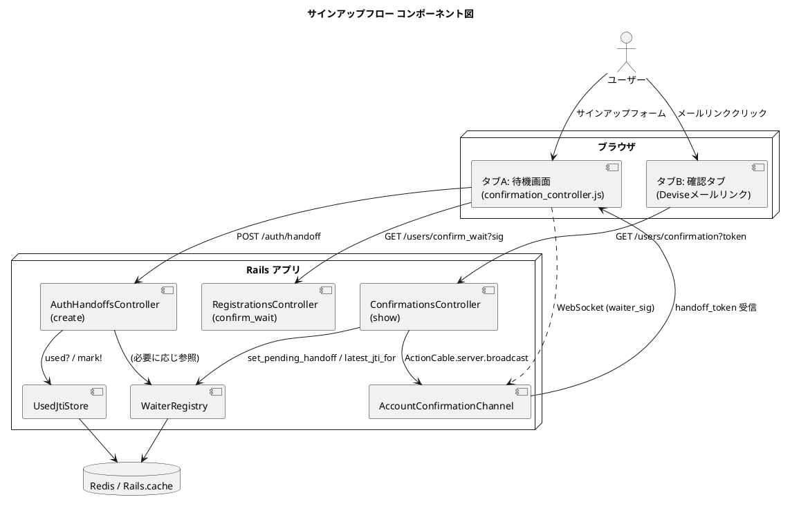

# サインアップ処理フロー ガイド

作成 — 2026年4月18日
更新 — 2026年10月（公開版のコードに合わせ、待機タブの移り先・確認済みリンクの扱い・`/auth/handoff` の CSRF の説明を直した）
対象 — 本アプリの「新規登録 → メール確認 → 自動ログイン」までの流れを、後から読んで思い出せるようにするための資料。

---

## 0. 前提：なぜこんなに複雑なのか？

通常の Devise（confirmable）なら「メールリンクを踏む → 踏んだタブでログイン」で終わる。
本アプリはそれに加えて、**「元のタブ（サインアップしたタブ）の方で自動的にログインを成立させて画面を切り替える」** という要件があるため、2つのタブをまたいでログイン状態を橋渡しする仕組みが必要になる。

- **タブA（待機タブ）** — サインアップフォームを送信したタブ。「メール確認待機中」画面を開いたまま待つ。
- **タブB（確認タブ）** — メール内リンクをクリックして開かれる新規タブ。Devise が実際にメール確認を行う。

タブA と タブB は別ブラウザセッションのように見える（リクエストが独立している）ため、サーバ側で「タブAにログインを引き渡す」ための仕掛けが必要になる。それが **ActionCable（WebSocket）+ ハンドオフトークン** の組み合わせ。

---

## 1. 時系列フロー（処理の流れ）

```
【タブA：待機タブ】                              【サーバ】                              【タブB：確認タブ】
   │                                                │
   │  ① POST /users （サインアップフォーム送信）   │
   │ ─────────────────────────────────────────────▶ │
   │                                                │  Users::RegistrationsController#create
   │                                                │  （Devise 標準：ユーザー作成＋確認メール送信）
   │                                                │
   │  ② 署名付きsig付きで /users/confirm_wait へ    │
   │ ◀──────────────────────────────────────────── │  after_inactive_sign_up_path_for
   │                                                │
   │  ③ GET /users/confirm_wait?sig=XXXX            │
   │ ─────────────────────────────────────────────▶ │
   │                                                │  Users::RegistrationsController#confirm_wait
   │                                                │  sig を検証 → @user, @waiter_sig, jti を発行
   │                                                │  WaiterRegistry に「最新 jti」を保存
   │  ④ confirm_wait.html.erb を返す                │
   │ ◀──────────────────────────────────────────── │
   │                                                │
   │  ⑤ Stimulus が ActionCable を購読              │
   │ ═══ WebSocket ═══════════════════════════════▶ │  AccountConfirmationChannel#subscribed
   │    waiter_sig を送って本人確認                 │  waiter_sig を検証
   │                                                │  stream_from "confirmation_wait:#{jti}"
   │                                                │
   │      （ここで待機... ユーザーがメールを確認する）
   │                                                │
   │                                                │  ⑥ GET /users/confirmation?token=...            │
   │                                                │ ◀──────────────────────────────────────────── │
   │                                                │  Users::ConfirmationsController#show            │
   │                                                │  - confirm_by_token でメール確認済みに          │
   │                                                │  - このタブ（タブB）に sign_in                  │
   │                                                │  - handoff_token を生成                         │
   │                                                │  - WaiterRegistry.set_pending_handoff（保険）   │
   │                                                │  - ActionCable.server.broadcast で タブA へ     │
   │                                                │                                                 │
   │  ⑦ ActionCable 経由で受信                      │                                                │
   │ ◀═══ { handoff_token: "..." } ═══════════════ │  ⑧ 「メール確認が完了しました」画面（タブBはすぐ閉じる）
   │                                                │ ─────────────────────────────────────────────▶ │
   │  ⑨ POST /auth/handoff { token }                │
   │ ─────────────────────────────────────────────▶ │
   │                                                │  AuthHandoffsController#create
   │                                                │  - handoff_token を検証
   │                                                │  - UsedJtiStore.used? で使い回し防止
   │                                                │  - bypass_sign_in(user) でタブAもログイン成立！
   │  ⑩ { ok: true, user_id }                       │
   │ ◀──────────────────────────────────────────── │
   │                                                │
   │  ⑪ window.location.assign("/profile/edit?from=confirmation")
   │     プロフィールの変更画面へ遷移（タブA ログイン完了！）
   │                                                │
```

---

## 2. ファイル一覧（時系列順）

処理が実行される順に並べてある。各ファイルについて「目的」と「主要メソッド」を解説する。

| # | ファイル | 役割 |
|---|---|---|
| ① | `config/routes.rb` | URL とコントローラーの対応を定義 |
| ② | `app/controllers/users/registrations_controller.rb` | 登録＋確認待機画面の表示 |
| ③ | `app/views/devise/registrations/confirm_wait.html.erb` | 待機画面（Stimulus 起動用） |
| ④ | `app/javascript/controllers/confirmation_controller.js` | 待機タブ側の WebSocket クライアント |
| ⑤ | `app/javascript/channels/consumer.js` | ActionCable 接続の入口（共通） |
| ⑥ | `app/channels/application_cable/connection.rb` | WebSocket 接続の認証基盤 |
| ⑦ | `app/channels/account_confirmation_channel.rb` | 待機タブ向けのチャンネル本体 |
| ⑧ | `app/services/waiter_registry.rb` | 待機情報・保留ハンドオフの保管庫 |
| ⑨ | `app/controllers/users/confirmations_controller.rb` | メール確認リンクの受け口 |
| ⑩ | `app/controllers/auth_handoffs_controller.rb` | ハンドオフトークン→ログイン成立 |
| ⑪ | `app/services/used_jti_store.rb` | 使い捨てトークンの再利用防止 |
| ⑫ | `app/controllers/pages_controller.rb` | タブB の完了通知画面 |

---

### ① `config/routes.rb`

**目的** — URL とコントローラー／アクションの対応を定義。

**関係する行：**

```ruby
devise_for :users, controllers: {
  registrations: 'users/registrations',
  confirmations: 'users/confirmations',
  ...
}
devise_scope :user do
  # 確認待ち画面（署名付きsigをクエリで渡す）
  get "users/confirm_wait", to: "users/registrations#confirm_wait", as: :wait_for_confirmation
  delete 'users/:id', to: 'users/registrations#destroy', as: :destroy_user
end

# ハンドオフ成立エンドポイント
post "auth/handoff" => "auth_handoffs#create"

# ActionCable のマウント
mount ActionCable.server => '/cable'
```

**初心者向けポイント：**
- `devise_for` は Devise が提供する汎用ルーティング。`controllers:` 指定で自作コントローラーに差し替えている。
- `mount ActionCable.server => '/cable'` は「WebSocket の入口」を `/cable` に置く設定。ブラウザ側はここに接続する。

---

### ② `app/controllers/users/registrations_controller.rb`

**目的** — Devise の RegistrationsController を拡張し、以下を担う：

1. 新規登録（`create`：Devise 標準継承）
2. 登録後のリダイレクト先を「署名付きURLの confirm_wait」にする（`after_inactive_sign_up_path_for`）
3. 確認待機画面の表示（`confirm_wait`）
4. 自分自身の情報のみ編集／削除可（`correct_user` フィルタ）

**主要メソッド：**

| メソッド | 役割 |
|---|---|
| `destroy` | ユーザー削除。`correct_user` で本人チェック済の前提。 |
| `confirm_wait` | 署名付き sig を検証 → `@user` と `@waiter_sig`（待機用署名）と `jti` を生成してビューへ渡す。 |
| `after_inactive_sign_up_path_for(resource)` | **（protected）** 未認証ユーザーのサインアップ直後の遷移先。`:id` を URL に出さず、署名付きトークンを付けた `/users/confirm_wait?sig=...` を返す。 |
| `correct_user` | **（protected）** URL の `:id` と `current_user.id` が一致しない場合は root にリダイレクト。他人の ID での destroy を防ぐ。 |
| `verify_confirm_wait_sig(sig)` | **（private）** `confirm_wait_access` 用の `message_verifier` で sig を検証し、uid を返す。期限切れ／改ざんは nil。 |
| `edit_email` / `update_email` / `edit_password` / `update_password` | メールとパスワードの独立編集（サインアップフローとは別の機能）。 |

**初心者向けポイント：**
- **署名付き sig** — `Rails.application.message_verifier(:purpose)` で生成する「改ざん検知可能な短命トークン」。URL に `?sig=XXXX` として載せても、中身の改ざんはサーバ側で検知できる。これにより `/users/confirm_wait/:id` のような「ID直置き URL」で他人のメールが覗かれる情報漏えいを防いでいる。
- **jti（JSON Web Token ID）** — そのタブに固有のランダムなID。同じユーザーが複数タブを開いても、jti が違えば別タブとして区別できる。

---

### ③ `app/views/devise/registrations/confirm_wait.html.erb`

**目的** — 待機画面の HTML。Stimulus コントローラーを起動するための data 属性を埋め込む。

**重要な data 属性：**

```erb
<div data-controller="confirmation"
     data-confirmation-waiter-sig-value="<%= @waiter_sig %>"
     data-turbo-permanent>
```

**初心者向けポイント：**
- `data-controller="confirmation"` の指定で、Stimulus が `confirmation_controller.js` を自動的に起動する。
- `data-xxx-yyy-value="..."` の形式で、JS 側に値を渡せる（Stimulus の values API）。
- `data-turbo-permanent` — Turbo が画面遷移時にこの DOM を保持する指定。WebSocket 接続が途切れないようにするため。

---

### ④ `app/javascript/controllers/confirmation_controller.js`

**目的** — 待機タブ側の JavaScript。`AccountConfirmationChannel` を購読し、メール確認完了のメッセージが来たら `/auth/handoff` を叩いて自タブをログインさせる。

**主要メソッド：**

| メソッド | 役割 |
|---|---|
| `connect()` | Stimulus のライフサイクル。DOM 接続時に `subscribe()` を呼ぶ。 |
| `disconnect()` | DOM 離脱時に購読解除。 |
| `subscribe()` | `AccountConfirmationChannel` を `waiter_sig` 付きで購読。`received` コールバックで `handoff_token` を受信。 |
| `unsubscribe()` | ActionCable 購読を解除。 |
| `performHandoff(handoffToken)` | `POST /auth/handoff` にトークンを送信。成功したら自タブをログイン状態で `/profile/edit?from=confirmation`（登録の直後にプロフィールを入れてもらう画面）へ遷移。 |

**初心者向けポイント：**
- **Stimulus** — Hotwire（Rails 標準）の JS フレームワーク。HTML の data 属性と JS クラスを自動で結びつける。
- **`consumer.subscriptions.create(...)`** — ActionCable の購読開始。第一引数の hash（`channel:`, `waiter_sig:`）はサーバ側で `params[:...]` として受け取れる。
- **`fetch(..., { credentials: "same-origin" })`** — 同一オリジンの Cookie（セッションCookie）を送信する指定。これが無いとサーバ側でセッションを確立できない。

---

### ⑤ `app/javascript/channels/consumer.js`

**目的** — ActionCable の入口を1本に集約。全チャンネルが共通でこの consumer を使う。

```js
import { createConsumer } from "@rails/actioncable"
export default createConsumer()
```

**初心者向けポイント：**
- **consumer** — WebSocket 接続を管理するオブジェクト。アプリ全体で1つだけ作り、各チャンネルで使い回すのが定石。
- `createConsumer()` は引数を省略すると HTML の `action_cable_meta_tag` から接続先を拾う。開発環境／本番環境で URL を自動切替できる。

---

### ⑥ `app/channels/application_cable/connection.rb`

**目的** — WebSocket 接続ごとの基盤クラス。Warden（Devise の内部認証）からログインユーザーを拾って `current_user` として保持する。

**主要メソッド：**

| メソッド | 役割 |
|---|---|
| `connect` | WebSocket ハンドシェイク時に呼ばれる。`env['warden']&.user(:user)` で既ログインなら `current_user` にセット。 |

**初心者向けポイント：**
- 本来 `reject_unauthorized_connection` で未ログイン接続を拒否するのが定石だが、**このアプリでは「メール確認待機中のタブ（＝まだログインしていない）」も WebSocket を張る必要がある**ため、未ログイン接続も受け入れている。
- 代わりに認証は **チャンネル側（AccountConfirmationChannel）で `waiter_sig` の検証**で行う。
- **Warden** — Rack レベルのセッション認証フレームワーク。Devise の中身はこれ。`env['warden']` で現在の認証状態にアクセスできる。

---

### ⑦ `app/channels/account_confirmation_channel.rb`

**目的** — 待機タブ専用のチャンネル。購読開始時に `waiter_sig` を検証し、本人の jti 単位でプライベートストリームを張る。

**主要メソッド：**

| メソッド | 役割 |
|---|---|
| `subscribed` | 購読開始時のコールバック。`waiter_sig` を検証 → 失敗なら `reject`、成功なら `stream_from "confirmation_wait:#{jti}"`。さらに `pending_handoff` があれば即 `transmit`（レース対策）。 |
| `verify_waiter_sig(sig)` | **（private）** `message_verifier(:waiter)` で sig を検証し `[uid, jti]` を返す。改ざん／期限切れは `[nil, nil]`。 |

**初心者向けポイント：**
- **stream_from "名前"** — その名前のチャンネルに流れてくるメッセージをこの購読者に転送するようサーバへ登録する。`ActionCable.server.broadcast("名前", payload)` でサーバ側から配信できる。
- **pending_handoff（保留ハンドオフ）** — タブB のメール確認処理（ブロードキャスト）がタブA の `subscribe` より先に走ってしまった場合の保険。`WaiterRegistry` に短期保存しておき、後から subscribe してきたタブに即座に `transmit` で渡す。
- **transmit** — 特定の購読者1名だけに送信する（broadcast と違い、ストリーム全体ではない）。

---

### ⑧ `app/services/waiter_registry.rb`

**目的** — ユーザーID をキーに、短命の待機情報を保管する Service Object。本番は Redis、無ければ `Rails.cache`（NullStore なら `MemoryStore`）に自動フォールバック。

**主要メソッド（クラスメソッド）：**

| メソッド | 役割 |
|---|---|
| `set_latest_jti_for(uid, jti, ttl:)` | ユーザーの「最新 jti（＝今開いている待機タブの識別子）」を保存。 |
| `latest_jti_for(uid)` | 保存された最新 jti を取得。ConfirmationsController がどのストリームへ broadcast するか決めるのに使う。 |
| `set_pending_handoff(uid, token, ttl:)` | ハンドオフトークンを保留保存（subscribe がまだだった場合の保険）。 |
| `take_pending_handoff(uid)` | 保留トークンを取得＆削除（1回限りの使い捨て）。 |
| `available?` | バックエンドが使える状態かの運用確認用フラグ。 |

**初心者向けポイント：**
- **Service Object** — モデルでもコントローラーでもない、特定の仕事を担うクラス。Rails 標準の概念ではないが、ロジック分割のベストプラクティス。
- **TTL（Time To Live）** — キャッシュの有効期限。期限が過ぎると自動削除される。トークンを永遠に残さないためのセキュリティ対策。
- **NullStore フォールバック** — Rails の dev 環境では `Rails.cache` が「何も書かないダミー（NullStore）」になっていることがある。そのままだとテストで失敗するので、このクラスは自前で `MemoryStore` を用意している。

---

### ⑨ `app/controllers/users/confirmations_controller.rb`

**目的** — Devise の ConfirmationsController を拡張。メールリンクの「クリック → 確認済みに変える → 待機タブへ引換券を通知」を担う。

**主要メソッド：**

| メソッド | 役割 |
|---|---|
| `show` | メール確認本体。`confirm_by_token` で確認済みに → このタブをログイン → 待機タブへ broadcast → 通知画面へリダイレクト。 |
| `after_confirmation_path_for(_, _)` | **（protected）** 確認後の遷移先を `page_mail_check_path`（通知画面）にする。 |
| `handle_confirmation_failure` | **（private）** 失敗時の処理。既に確認済みなら、正常系と同じく待機タブへ引換券を送って確認完了の画面へ（何度踏んでも同じ結果になる）。トークン不正・期限切れは通知画面へ。 |
| `sign_in_confirmed_user` | **（private）** このタブ（タブB）で `sign_in`。二重ログインは避ける。 |
| `broadcast_handoff_to_waiter` | **（private）** `handoff_token` を生成→ `WaiterRegistry.set_pending_handoff` に保留保存→ `latest_jti_for` があれば broadcast。 |

**初心者向けポイント：**
- **handoff_token（ハンドオフトークン／引換券）** — 「この uid のユーザーとしてログインしてよい」という短命の引換券。`Rails.application.message_verifier(:confirm_handoff)` で署名＋期限付きに生成。
- **レース対策（pending_handoff + broadcast の両方をやる理由）** — タブA の `subscribe` とタブB の `show` はどちらが先に走るか保証できない。先後どちらでも拾えるよう、**「broadcast（先に subscribe 済みならこれで届く）」＋「pending_handoff（まだなら後から取りに来てもらう）」** を両方仕込む。
- **メールスキャナ対策** — Gmail・Outlook のリンクの先読みや、企業メールのセキュリティソフトは、メール内の URL を本人より先に踏むことがある。すると1回目で確認が済み、本人のクリックは `already_confirmed` エラーになる。ここでエラー画面を出すと本人には「失敗」に見えるので、正常系と同じく待機タブへ引換券を送り、確認完了の画面へ導いている（冪等）。

---

### ⑩ `app/controllers/auth_handoffs_controller.rb`

**目的** — `handoff_token` を受け取って、このリクエストのセッションでログインを成立させる。

**主要メソッド：**

| メソッド | 役割 |
|---|---|
| `create` | `POST /auth/handoff` のハンドラ。token を検証 → uid / jti / exp を取り出し → 期限／リプレイチェック → `bypass_sign_in(user)` でログイン成立 → JSON レスポンス。 |

**初心者向けポイント：**
- **`bypass_sign_in(user)`** — Devise のメソッド。通常の `sign_in` と違い、コールバック（trackable など）をスキップする。今回はすでに別タブで確認済みなので、コールバックを再度走らせたくない。
- **リプレイ攻撃（Replay attack）** — 同じトークンを何度も使い回して不正ログインを試みる攻撃。`UsedJtiStore` で「1回使った jti は記録して拒否」することで防ぐ。
- **CSRF 検証は外している（`skip_forgery_protection`）** — Devise はサインインのときに CSRF トークンを作り直す。別のタブ（タブB）でサインインが走ると、タブA が持っている CSRF トークンが無効になり、`POST /auth/handoff` が 422 で止まってしまう。代わりに、署名付きの handoff_token（期限つき・jti の使い回し不可）で本人であることを確かめている。

---

### ⑪ `app/services/used_jti_store.rb`

**目的** — 使い捨て jti の「使用済み」判定。`WaiterRegistry` と同じく Redis/Cache に自動フォールバック。

**主要メソッド：**

| メソッド | 役割 |
|---|---|
| `used?(jti)` | その jti が既に使われたか？ |
| `mark!(jti, ttl:)` | その jti を「使用済み」にマーク。 |
| `available?` | バックエンドの利用可否。 |

**初心者向けポイント：**
- `WaiterRegistry` と役割が似ているので混同しがち。
  - `WaiterRegistry` — 「uid → 最新jti／保留トークン」の双方向参照。
  - `UsedJtiStore` — 「jti → 使用済みか？」の片道チェック。
- 両者で役割を分けておくことで、1つが壊れてももう1つで補えるという冗長構成になる。

---

### ⑫ `app/controllers/pages_controller.rb` / `app/views/pages/mail_check.html.erb`

**目的** — タブB がメール確認を終えた後に見せる「完了通知画面」。タブB はすぐ閉じる想定。

**主要メソッド：**

| メソッド | 役割 |
|---|---|
| `mail_check` | flash[:page] やクエリパラメータから @title / @message / @type を組み立てる。Timeoutable の誤判定を避けるため `devise.skip_timeout` を設定。 |

**初心者向けポイント：**
- **flash[:page]** — Rails 標準の flash（一度だけ生きるセッションデータ）を使って、リダイレクト元→先へ画面内容を受け渡している。
- **devise.skip_timeout** — Devise の Timeoutable モジュールが「前回アクセスから時間が経ちすぎ」と誤判定するのを、この1リクエストだけ緩めるためのフラグ。

---

## 3. 重要概念まとめ（Rails 初心者向け用語集）

| 用語 | 一言で |
|---|---|
| **ハンドオフトークン（handoff_token）** | 「この uid のユーザーとしてログインしてよい」という短命の引換券。署名付き。 |
| **waiter_sig** | 待機タブが自分のことをサーバへ申告するときに使う、サーバ署名済みの識別トークン。 |
| **confirm_wait_access sig** | `/users/confirm_wait` URL の改ざん防止＋期限管理用の署名。 |
| **jti (JSON Web Token ID)** | 「このトークン／このタブ」に固有のランダムID。リプレイ防止の軸になる。 |
| **message_verifier** | Rails 標準の署名機構。`Rails.application.message_verifier(:purpose)` で改ざん検知可能なトークンを生成・検証できる。 |
| **purpose** | message_verifier の「用途識別子」。purpose が違うと他のトークンで流用できない。 |
| **ActionCable** | Rails が提供する WebSocket フレームワーク。 |
| **Channel** | ActionCable の論理チャンネル。購読単位。 |
| **stream_from "名前"** | そのストリームに流れるメッセージを受け取るようサーバに登録する。 |
| **broadcast / transmit** | broadcast = ストリーム全員へ／ transmit = この購読者1名へ。 |
| **Warden** | Devise の内部で使われている Rack 認証機構。 |
| **bypass_sign_in** | Devise のログイン成立メソッド。コールバックをスキップする版。 |
| **Stimulus** | Hotwire の JS フレームワーク。data 属性と JS クラスを結びつける。 |
| **Service Object** | モデルでもコントローラーでもない、特定の役割を持つクラス。 |
| **NullStore → MemoryStore フォールバック** | 開発環境で `Rails.cache` が「何も書かないダミー」のとき、自前の MemoryStore に切り替える仕組み。 |
| **リプレイ攻撃** | 同じトークンを使い回す攻撃。`UsedJtiStore` で1回使った jti を記録して防ぐ。 |
| **レース条件（race condition）** | タブA の subscribe とタブB の show、どちらが先に走るか保証できない状態。`pending_handoff` + `broadcast` の両用で吸収している。 |

---

## 4. 図解用の指示テンプレート

本資料をベースに図に起こしたい場合、以下の指示を AI 作図ツール（ChatGPT 画像生成／Mermaid／PlantUML 等）に渡すとよい。

### 4.1 Mermaid（sequenceDiagram）用

GitHub／GitLab／VSCode の Markdown プレビューでそのまま描ける。このファイル内にコピーして閲覧するだけで図になる。



### 4.2 PlantUML（コンポーネント図）用

関係者とコンポーネントの全体像を描きたいとき：



### 4.3 ChatGPT / Claude 画像生成への指示文テンプレート

> 「Rails アプリのサインアップフローを、シーケンス図として手書き風に描いてください。
> 縦軸は時間、横軸には『ユーザー』『タブA（待機タブ）』『タブB（確認タブ）』『Rails サーバ』『ActionCable』『WaiterRegistry』の6レーンを用意。
> 次の11ステップを矢印で描写：
> ①サインアップフォーム送信 ②署名付き sig でリダイレクト ③待機画面取得 ④WebSocket 購読 ⑤メールリンククリック ⑥メール確認 ⑦タブBログイン ⑧broadcast ⑨handoff_token 受信 ⑩POST /auth/handoff ⑪タブAログイン成立＆プロフィールの変更画面へ遷移。
> レーンの色は薄い水色、矢印は黒、重要なトークン（handoff_token, waiter_sig, jti, sig）は赤で強調してください。」

### 4.4 draw.io / Miro など手動描画ツール用の指示

> 6レーン（縦）× 11ステップ（横） のシーケンス図を作成。
> - レーン：ユーザー／タブA／タブB／Railsサーバ／ActionCable／WaiterRegistry+UsedJtiStore
> - 各ステップに番号と「誰から誰へ・何を渡すか」を1行で記載
> - トークン種別（sig, waiter_sig, handoff_token, jti）は色分け（sig=青, waiter_sig=緑, handoff_token=赤, jti=オレンジ）
> - 「pending_handoff」と「broadcast」の二系統を明示
> - 「レース対策」「リプレイ防止」の注釈を吹き出しで追加

---

## 5. 参考：関連する RSpec テスト

各ファイルに対応するテストも合わせて読むと流れが掴みやすい。

| テスト | 検証対象 |
|---|---|
| `spec/requests/users/registrations_spec.rb` | destroy 認可、confirm_wait の sig 検証、サインアップ後リダイレクト先、メールアドレス・パスワードの変更 |
| `spec/requests/users/confirmations_spec.rb` | メール確認成功／失敗、pending_handoff 保存、broadcast 挙動 |
| `spec/requests/auth_handoffs_spec.rb` | handoff_token 検証、jti リプレイ防止、失敗時ステータス |
| `spec/channels/account_confirmation_channel_spec.rb` | waiter_sig 検証、pending_handoff 即時 transmit |
| `spec/services/waiter_registry_spec.rb` | set/latest_jti, set/take_pending_handoff |
